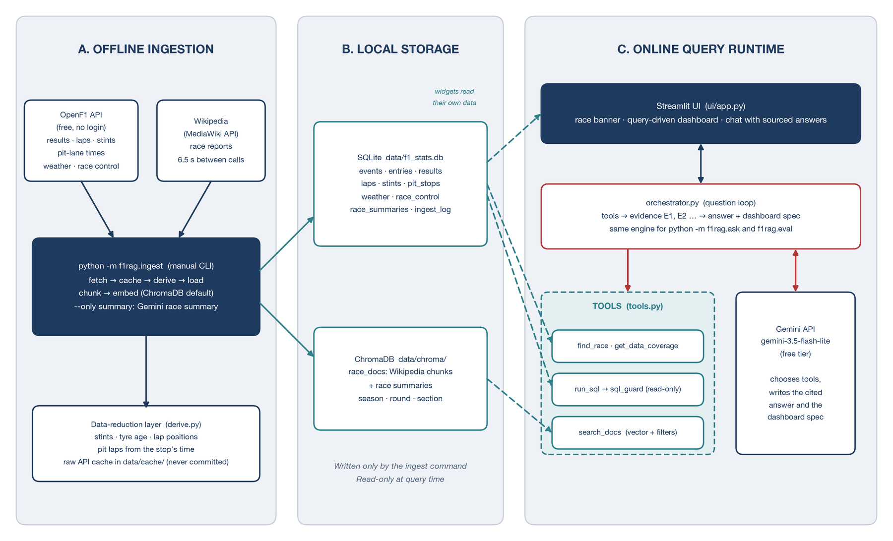
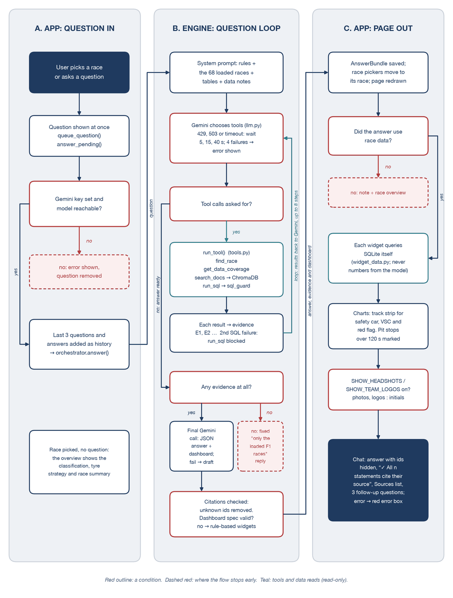

# Architecture

A short summary of how the chatbot is built. The full design lives in the project's technical documentation.

## Overview

Three parts, kept apart on purpose:

- **Offline ingestion** (`f1rag/ingest/`): a manual command loads OpenF1 race data into SQLite and Wikipedia race reports into ChromaDB, derives stints, tyre age and lap positions, and can write a short race summary with Gemini. It is idempotent and resumable.
- **Local storage**: one SQLite file (10 tables, every row keyed by season and round) and one ChromaDB collection (`race_docs`, one chunk per report section, with season, round and source metadata). Written only by ingestion.
- **Online query runtime**: the Streamlit app and the `ask` command share one engine that only reads.

## Query flow

1. The system prompt gives Gemini the rules, the loaded races, the table descriptions and data notes.
2. Gemini calls tools in a loop of up to eight steps: `find_race`, `get_data_coverage`, `run_sql` (through a read-only SQL guard) and `search_docs` (ChromaDB). Every result becomes evidence E1, E2 and so on.
3. A final call returns the answer and a dashboard spec as JSON. Citations to evidence that does not exist are removed; an invalid spec is replaced by widgets chosen by rules.
4. The app draws each widget from its own database query, so the model never supplies chart numbers, and shows how many statements cite a source.

## Key modules

| Module | Role |
|---|---|
| `engine/orchestrator.py` | The question loop: tools, evidence, final answer, dashboard plan |
| `engine/tools.py` | The four tools and their descriptions for Gemini |
| `engine/sql_guard.py` | Read-only connection, SELECT only, one statement, row and time limits |
| `engine/evidence.py` | Evidence ids, citation checks, cited and uncited statements |
| `engine/dashboard_planner.py` | Validates the model's dashboard spec (pydantic) or builds one by rules |
| `engine/llm.py`, `engine/prompts.py` | Gemini wrapper with retries; system prompt and answer schema |
| `ui/` | Streamlit page, widgets and the database queries behind them |
| `golden.py`, `eval.py` | Golden question set scoring and the evaluation command |

## Key decisions

- **Agentic routing over a fixed pipeline:** statistics must come from SQL and reasons from reports, so the model chooses the source per question.
- **Safety in code, not in the prompt:** SQL is limited by a read-only connection and an authorizer; the prompt is never a security control.
- **Evidence for every fact:** each tool result gets an id, answers may cite only real ids, and the eval checks the numbers against the database.
- **Model picks widgets, code fetches data:** chart numbers never pass through the model.
- **Free and local:** OpenF1 instead of FastF1 (which now needs a paid login), ChromaDB's local embedding model, Gemini 3.5 Flash-Lite on the free tier (500 requests a day).

## Lessons in brief

- Check an external service's current cost, login and limits before planning around it: FastF1 changed to a paid login.
- Free-tier model calls take seconds each, so round trips matter: listing the loaded races in the prompt cut the median answer from 17.9 s to 4.3 s.
- Data sources disagree in small ways (two names for the virtual safety car, pit laps counted by the in or out lap, red-flag waits stored as pit stops); each one is handled in code or in the prompt's data notes.
- An evaluation set with expected answers computed from the data catches regressions that unit tests cannot.
